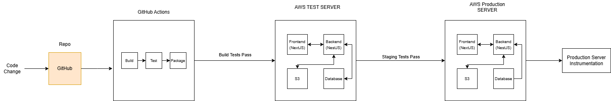

# Photo Repo: SWE40006 Group 06

A web-based photo upload app, built to demonstrate a DevOps pipeline: GitHub, GitHub Actions CI, Docker, and Prometheus/Grafana monitoring.

Hosts create an event and share its link or QR code. Guests open it on their phone, take or choose a photo, check it, and upload it to that event's gallery. No accounts are needed: the event link itself grants access.



| Part | Technology |
| ---- | ---------- |
| Frontend | Next.js 16 (React 19) |
| Backend API | NestJS 12 |
| Database | PostgreSQL 17 |
| Monitoring | Prometheus, Alertmanager, Grafana, node-exporter |
| CI | GitHub Actions |
| Deployment | Docker Compose on AWS EC2 |

## Quick start

### 1. Prerequisites

- [Docker Desktop](https://www.docker.com/products/docker-desktop/), installed and running
- Node.js 24 and pnpm 11, only needed to run the tests outside Docker (`npm install -g pnpm@11.21.0`)

### 2. Configure

```sh
cp .env.example .env
```

Edit `.env` and set `GRAFANA_ADMIN_PASSWORD`, `DB_PASSWORD` and `ADMIN_PASSWORD`, which is the host login for creating events and viewing metrics. Any values work locally. `.env` is gitignored, so never commit it.

`.env` also sets `COMPOSE_FILE`, which tells Docker Compose which compose files to combine, so the commands below don't need any `-f` flags. The example is set up for Docker Desktop on Windows and macOS. On a Linux server such as EC2, switch to the commented-out Linux line.

| File | What it adds |
| ---- | ------------ |
| `compose.yaml` | The app: frontend, backend, postgres |
| `compose.monitoring.yaml` | Prometheus, Alertmanager, Grafana, node-exporter |
| `compose.desktop.yaml` | Docker Desktop only: a mount option node-exporter needs there (Docker Desktop rejects the Linux one) |

### 3. Run

```sh
docker compose up -d --build
```

On Docker Desktop, the host CPU, memory, disk and network figures come from Docker Desktop's built-in Linux virtual machine, not from Windows or macOS itself. On EC2 they're the server's real figures.

### 4. Open

| What | URL |
| ---- | --- |
| Host dashboard: create events, get QR codes | <http://localhost:3000/host>, logging in with `ADMIN_PASSWORD` from `.env` |
| Guest event page | `http://localhost:3000/e/<token>`, opened from an event's link or QR code |
| Metrics dashboard | <http://localhost:3000/admin/metrics>, hosts only |
| Grafana | <http://localhost:3002>, logging in with the Grafana user and password from `.env` |
| Prometheus | <http://localhost:9090>, no login |
| Alertmanager | <http://localhost:9093>, no login |
| Backend readiness | <http://localhost:3001/health/ready> |

Prometheus and Alertmanager have no authentication, so they only accept connections from the machine they run on. On EC2, reach them through an SSH tunnel: `ssh -L 9090:localhost:9090 -L 9093:localhost:9093 <server>`. Grafana is the only tool with a login. These ops tools are deliberately left out of the app's navbar, which guests see.

### Stopping

```sh
docker compose down      # keeps photos and metrics
docker compose down -v   # also deletes all data
```

After pulling changes, rerun the start command; `--build` rebuilds what changed.

## How it fits together

```text
Browser ──► frontend :3000 ──/api/backend/*──► backend :3001 ──► postgres :5432
                │                                  ▲
                └──/api/metrics──► prometheus ─────┘ scrapes /metrics every 15s
                                       │
                                       └──► alertmanager ──► (notification channel)
                                       └──► grafana :3002
```

- **The browser only talks to the frontend.** API requests go to `/api/backend/…` on the frontend, which forwards them to the backend. That's why the app works from a phone opening the QR link, and on EC2, without a hard-coded backend address. The backend address comes from the `BACKEND_URL` setting.
- **Events and photos are stored in PostgreSQL** in the `events` and `user_photos` tables. Every photo belongs to an event, and deleting an event deletes its photos. The backend creates the tables when it starts (photos from before events existed are moved into an "Earlier photos" event), and the data lives in the `postgres-data` volume, so it survives redeploys.
- **Events:** the host logs in on `/host`, creates an event and gets a link with a random 128-bit token (`/e/<token>`) and a QR code. Anyone with the link can add and view that event's photos, and nothing else. A photo can only be fetched through its own event's token, so other events' photos can't be reached by guessing IDs.
- **Host login:** one shared `ADMIN_PASSWORD`, with no user accounts (the brief puts complex account systems out of scope). It sets a signed, httpOnly session cookie that lasts 12 hours. After 5 wrong passwords in a minute, logins are blocked for a minute. Hosts can create, rename and delete events, delete photos, and view metrics.
- **The guest journey:** scan the event's QR code, take a photo or choose one, check the preview, add a description, approve it, and see it in the gallery straight away.
- **Camera access:** the in-page camera only works over HTTPS or on `localhost`, which is a browser rule. Over plain HTTP, such as a phone on `http://<server-ip>:3000`, "Take a photo" opens the phone's own camera app instead, so the journey still works. HTTPS on EC2 enables the in-page camera there too.
- **Where the QR code points:** set `PUBLIC_URL` in `.env` on EC2 to the address guests use. When it's unset, the code uses whatever address `/host` was opened on.
- **Uploads are validated.** Files must be JPEG, PNG, GIF, WebP or HEIC, checked from the file contents rather than the name, and 10 MB or smaller. A description is required, up to 500 characters.
- **The backend reports its own health.** `GET /health` says whether the backend is up. `GET /health/ready` also checks the database and returns 503 if it's unreachable.

### Backend API

| Method | Path | Purpose |
| ------ | ---- | ------- |
| `POST` | `/auth/login` | Host login (`{ "password": "…" }`); sets the session cookie |
| `POST` | `/auth/logout` | Clears the session cookie |
| `GET` | `/auth/me` | `{ "authenticated": true/false }` |
| `GET` `POST` | `/events` | Host: list events (with photo counts) / create one (`{ "name": "…" }`) |
| `PATCH` `DELETE` | `/events/:id` | Host: rename / delete an event and its photos |
| `DELETE` | `/photos/:id` | Host: delete a photo |
| `GET` | `/events/share/:token` | Guest: the event's name (404 for unknown links) |
| `GET` `POST` | `/events/share/:token/photos` | Guest: list the event's photos / upload one (multipart form: `photo` and `description`) |
| `GET` | `/events/share/:token/photos/:id/image` | Guest: the image itself, served with its real content type |
| `GET` | `/health` | Whether the backend is up |
| `GET` | `/health/ready` | Whether the backend can reach the database (503 if not) |
| `GET` | `/metrics` | Prometheus metrics |

## Project structure

```text
backend/                NestJS API
  src/                  controllers, services, metrics module
  test/                 end-to-end tests
frontend/               Next.js app
  app/e/[token]/        guest event page: upload flow and gallery
  app/host/             host dashboard: login, events, QR codes
  app/_components/      navbar, QR code, photo components (camera, preview and approve, gallery)
  app/admin/metrics/    metrics dashboard (hosts only)
  app/api/backend/      proxy from the browser to the backend
  app/api/metrics/      dashboard data, read from Prometheus
monitoring/             Prometheus, Alertmanager and Grafana config (see monitoring/README.md)
compose.yaml            app stack: frontend, backend, postgres
compose.monitoring.yaml monitoring stack, layered on top of compose.yaml
e2e/                    Playwright browser tests (full user journey)
.github/workflows/      CI pipelines and deployment
scripts/deploy.sh       runs on EC2: deploy, health-check, roll back on failure
docs/                   diagrams
```

## Testing

There are three layers of tests:

| Layer | Where | What it covers |
| ----- | ----- | -------------- |
| Unit | `backend/src/**/*.spec.ts` | Login sessions and throttling, image-type detection, health checks, metrics |
| API integration | `backend/test/*.e2e-spec.ts` | Every backend route against a real PostgreSQL: the host and guest flows, event isolation, upload validation |
| Browser end-to-end | `e2e/tests/*.spec.ts` | The full user journey in a real browser, on phone and desktop sizes: camera capture and preview/approve upload, the host dashboard, access rules |

### Browser end-to-end tests (Playwright)

These drive the **running** app, so start the stack first (`docker compose up -d --build`), then:

```sh
cd e2e
pnpm install
pnpm exec playwright install chromium     # once; or skip it and set PLAYWRIGHT_CHANNEL=msedge to use Edge
E2E_ADMIN_PASSWORD=<ADMIN_PASSWORD from .env> pnpm test
```

On Windows PowerShell, set the variables first: `$env:E2E_ADMIN_PASSWORD='…'; $env:PLAYWRIGHT_CHANNEL='msedge'; pnpm test`.

The same suite runs against any server, so it doubles as the **staging/production acceptance test**:

```sh
BASE_URL=http://13.239.43.240:3000 E2E_ADMIN_PASSWORD=<that server's ADMIN_PASSWORD> pnpm test
```

Each test creates its own uniquely named event and deletes it afterwards, so running against a live server leaves no test data behind. The in-page camera test only runs on `localhost` or HTTPS, because browsers block the camera elsewhere. Over plain HTTP the suite instead checks the fallback to the phone's camera app. `pnpm test:ui` opens Playwright's interactive runner, and after a failure `pnpm report` shows screenshots and a step-by-step trace.

Measured: 32 tests (16 on each of phone and desktop) in about 12 seconds, and 160 of 160 passed across 5 back-to-back runs with no retries, against the brief's < 1% flake target.

### Backend tests

```sh
cd backend
pnpm install
pnpm test            # unit tests
pnpm run test:e2e    # API integration tests
pnpm run build
```

The database tests in the API suite only run when the `DB_*` variables point at a PostgreSQL database; otherwise they are skipped. To run them locally against a temporary database:

```sh
docker run -d --rm --name photorepo-test-db -p 127.0.0.1:55432:5432 \
  -e POSTGRES_DB=photorepo_test -e POSTGRES_USER=photorepo -e POSTGRES_PASSWORD=photorepo \
  postgres:17.6-alpine

DB_HOST=127.0.0.1 DB_PORT=55432 DB_NAME=photorepo_test DB_USER=photorepo DB_PASSWORD=photorepo \
  pnpm run test:e2e

docker stop photorepo-test-db
```

## CI

| Workflow | Runs on | What it does |
| -------- | ------- | ------------ |
| [Backend CI](.github/workflows/backend-ci.yaml) | Every push and pull request | Unit tests, E2E tests against a real PostgreSQL, build |
| [Frontend CI](.github/workflows/frontend-ci.yaml) | Pushes and PRs to `main`/`develop` that change the frontend | Lint and production build |
| [E2E Tests](.github/workflows/e2e.yaml) | Changes to the app, tests or compose files | Starts the app and monitoring in fresh containers, then runs the Playwright suite in Chromium. On failure it uploads screenshots and traces |
| [Deployment](.github/workflows/deploy.yaml) | Manual (Actions → Deployment → Run workflow) | Builds images, copies them to EC2 and runs `scripts/deploy.sh`, which health-checks the release and rolls back automatically if it fails |
| [Monitoring CI](.github/workflows/monitoring-ci.yaml) | Changes to monitoring files | Validates the Prometheus, Alertmanager, Grafana and Compose config, and runs the alert-rule unit tests |

## Monitoring

Prometheus collects backend request performance, Node.js process stats, database availability and host CPU, memory, disk and network every 15 seconds.

Seven alert rules cover:

- the backend or database going down
- server errors above 1% of traffic over five minutes
- high latency
- low disk space, alerting at each 5% step
- sustained high CPU and memory

The in-app dashboard at `/admin/metrics` and the Grafana dashboard both show this data.

See [monitoring/README.md](monitoring/README.md) for how each success metric in the project brief is met, and for how to connect alert notifications.

## Deploying to EC2

**Actions → Deployment → Run workflow** builds the images, copies them to the instance with the compose files, monitoring config and Discord webhook, and runs [scripts/deploy.sh](scripts/deploy.sh). If the release fails its health checks, the script rolls back to the last healthy release, and the workflow run fails. In a rehearsal, a broken release was replaced in 73 s (brief target: 120 s).

### HTTPS

The production stack puts [Caddy](caddy/Caddyfile) in front of the app. It gets a free Let's Encrypt certificate and renews it automatically. HTTPS is what lets phones use the in-page camera, and it makes the host login cookie `Secure`. Browsers block both over plain HTTP.

There's no need to buy a domain: [sslip.io](https://sslip.io) turns the server's IP into a hostname, so `13.239.43.240` becomes `13-239-43-240.sslip.io`.

One-time setup:

1. **Elastic IP:** in EC2 → Elastic IPs, allocate one and associate it with the instance, so the IP (and therefore the hostname and certificate) survives restarts.
2. **Security group inbound rules:** open **80** (Let's Encrypt checks the server over HTTP, and Caddy redirects HTTP to HTTPS) and **443** (HTTPS) to `0.0.0.0/0`. Once HTTPS works, port **3000** can be closed. Keep **22** (deploys) and, if you use Grafana, **3002**.
3. **GitHub → Settings → Environments → production → Variables**, using the Elastic IP with dots replaced by dashes:
   - `SITE_ADDRESS` = `13-239-43-240.sslip.io`
   - `PUBLIC_URL` = `https://13-239-43-240.sslip.io` (the address in the QR codes)
4. Run the **Deployment** workflow. The log should end with `HTTPS ok: https://13-239-43-240.sslip.io`.

While `SITE_ADDRESS` is unset, Caddy serves plain HTTP on port 80, so a deploy never takes the site down before HTTPS is configured. The certificate is stored in the `caddy-data` volume, so redeploys don't request a new one.

Tested locally: Caddy in front of the stack (with a self-signed certificate for `localhost`) served every page, redirected HTTP to HTTPS, set HSTS, issued a `Secure` login cookie, passed a 41 s slow upload, and passed the full Playwright suite over HTTPS, including the in-page camera tests.

## Troubleshooting

| Problem | Fix |
| ------- | --- |
| `port 3000 is already allocated` | Another app, such as a local `next dev`, is using the port. Stop it and start again. |
| `Set DB_PASSWORD in .env` (or `GRAFANA_ADMIN_PASSWORD`, `ADMIN_PASSWORD`) | `.env` is missing or incomplete; see [Configure](#2-configure). |
| `docker` not recognised | Restart your terminal or VS Code after installing Docker. |
| Grafana login fails | Grafana only reads the password from `.env` the first time it starts; changing `.env` later has no effect. Reset it with `docker compose exec grafana grafana cli admin reset-admin-password <new-password>`. |
| "node is down" alert, or node-exporter fails to start | `COMPOSE_FILE` in `.env` is wrong for your machine. On Docker Desktop it must include `compose.desktop.yaml`; see [Configure](#2-configure). |
| `DiskSpaceLow` alert on Docker Desktop | It's real: Docker Desktop's virtual disk is filling up. `docker system prune` frees space. |
| Host login: "Too many failed attempts" | Wait a minute. Logins are blocked for a minute after 5 wrong passwords. |
| Forgot the host password | It's `ADMIN_PASSWORD` in `.env`. Change it there and run `docker compose up -d backend`; this also logs out every host. |
| Upload fails with "Could not reach the backend" | Check `docker compose ps`. The backend waits for Postgres to be healthy before it starts. |
| HTTPS on EC2 not working (deploy log says "not answering yet") | Check that inbound ports 80 and 443 are open, that `SITE_ADDRESS` matches the instance's current public IP, then read `docker logs photo-repo-caddy-1` on the server for the Let's Encrypt error. |
| Changed alert rules aren't taking effect | Reload Prometheus and Alertmanager; see [monitoring/README.md](monitoring/README.md). |

## Team

Tuesday 10:30am – 12:30pm, Group 06

- Matthew Bailey – 102146171
- Ari Fadida – 103433887
- Josh Bakanursky – 102551610